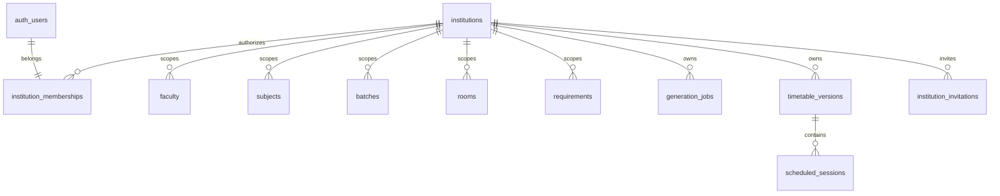
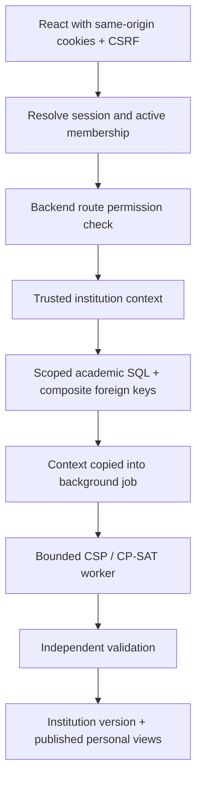

# Additive schema v6: password signup

`auth_profiles(user_id, name)` stores public signup profiles. Accounts without a membership
can authenticate into onboarding only, with computed role `unassigned`. A disabled membership
never falls back to this state. Explicit workspace creation grants only new-institution
administrator rights. Verification tables are retained for compatibility but no longer
used by authentication. No existing table is dropped by migration v6.

# Institution architecture inherited from v5

`institutions`: institution_id, institution_name, institution_type SCHOOL/COLLEGE,
created_at, status PENDING/ACTIVE/SUSPENDED. Existing data belongs to a fixed legacy
COLLEGE institution after the approved migration. Academic IDs remain unchanged.

Academic tables use institution_id plus existing local keys. Availability tables retain
auto-increment row IDs and an institution-qualified unique key. Foreign keys for
assignments, requirements, availability, sessions and class teachers include institution.
Publication uniqueness is per institution and academic scope. Historical timetable
snapshots retain their original academic descriptions even when the current catalog changes.

Memberships bind users to institution, role, scopes, active flag, faculty_id and batch_ids.
Teacher faculty links have composite foreign keys. Student batch lists are validated
against the trusted institution on creation/update/acceptance; they currently use JSON,
not a normalized enrollment table. Roles are administrator, planner, teacher, student,
viewer and locally provisioned platform_super_admin. Legacy user role columns remain
for data compatibility; membership role is authoritative at request time.

School batches add class_number (1-12), division/section, class_teacher_id and academic_year.
College batches retain department, semester and division. Departments and academic_years
have institution-local ID/name catalogs; legacy department/year labels remain free text
for compatibility. School calendars configure period length and recess/lunch windows.
School durations must be whole period multiples. Subject kind includes activity as well
as theory and lab. Activity uses a theory room; laboratory sessions require lab rooms.

## Request boundary

HTTP starts with no institution context; only a server-side membership sets it.
Request body institution_id is rejected. Catalog operations, aggregates, jobs, versions,
reports and exports use scoped connections. Nested academic SQL is rejected rather than
silently unscoped. Raw connections are reserved for authentication and explicit maintenance.
Background threads inherit the trusted context; solver subprocesses receive snapshots
and never query another institution's database records.

Administrators manage their institution. Planners manage requirements and drafts but
cannot publish or manage accounts. Teacher/student views contain only published assigned
faculty/batch sessions. Viewers see published timetables for granted academic scopes.
Platform operators can list/suspend institutions but cannot read academic data; provisioning
is local-only. Suspension revokes sessions. All state changes retain CSRF protection.

SQLite remains the supported runtime. Portable institution keys and SQLAlchemy types help
future PostgreSQL migration, but PostgreSQL operation and its migration path have not been
certified. This is application-enforced tenancy, not database row-level security.
