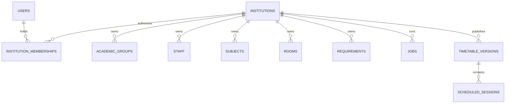

> Amendment (2026-11-11): Email + Password signup replaces mandatory email verification.
> Signup creates no administrator membership; explicit new-institution onboarding does.
> Invitations use administrator-shared private single-use links, without SMTP. Preserve
> existing password/session/CSRF/throttle/RBAC and institution boundaries. This supersedes
> earlier requirements for mandatory registration email delivery.

> Implementation update, 2026-11-08: School/College activation, memberships, invitations,
> adaptive academic management, shared scheduling and tenant-scoped views are implemented.
> See PROGRESS.md for executed test results and docs/OPERATIONS.md for deployment limits.
> The existing live database is deliberately not cut over; approval is still required.

# CampusFlow master development requirements

CampusFlow is an **Intelligent Academic Timetable Generation and Management
Platform for educational institutions**, supporting SCHOOL and COLLEGE as equal,
first-class institution types in the same application. This amendment extends the
existing project; it does not replace its scheduling, persistence or security work.

## Product invariants

- Preserve existing academic IDs, records, schedules, histories and user credentials.
- Reuse the current deterministic CSP and optional OR-Tools CP-SAT engines and
  independent validators. No duplicate school solver or unnecessary ML dependency.
- Keep FastAPI, React, SQLAlchemy and the selected shared-database architecture.
- Preserve generation jobs, bounded solver execution, draft editing, rescheduling,
  publication, version history, reports and CSV/PDF exports.
- Never derive authority from a client-supplied institution ID or institution type.
- No public deployment, GitHub push, paid service or destructive cutover without
  the applicable user authorization. School support is not a separate application.

## Registration and activation

The common registration form must contain Institution Type (School/College),
Institution Name, Administrator Full Name, Official Email, Password and Confirm
Password. Both types follow the same verification/security process. Official email
is a contact mailbox; its domain alone does not establish ownership of an institution.

Hash passwords with Argon2id; verify email through expiring, single-use, hashed
tokens. Require explicit confirmation, rate-limit sends/resends, and test the actual
provider transport. Public registration can create only a **new** institution and
its institution-administrator membership after verification. Never join an existing
institution by matching name/domain, grant global privileges, or bypass verification.

Administrators may invite teachers/faculty, students and coordinators into their own
institution. Bind invitations to recipient, institution and permitted role on the
server. Require expiring single-use acceptance, secure password setup, revocation,
and authenticated handling of already-existing identities.

## School capabilities

- Classes 1–12 and sections A/B/C (labels configurable, not identifiers shared globally).
- Teachers, subjects, classrooms, teacher availability and class-teacher assignments.
- Period-based days, configurable period lengths, lunch and recess breaks.
- Weekly subject-period requirements, optional laboratory and activity periods.
- Teacher-specific and student/class-section timetable views.
- Generation, validation, draft changes, publication and exports using shared services.

## College capabilities

- Departments, academic years, semesters, divisions and batches.
- Faculty, subjects, practical sessions, laboratories and classrooms.
- Variable lecture durations, faculty availability and weekly lecture requirements.
- Generation, validation, draft changes, rescheduling, publication, reports and exports.
- Preserve existing college behavior while adding explicit structures that are not
  yet modeled (for example academic years and department administration).

## Adaptive workspace

| Shared concept | School interface | College interface |
|---|---|---|
| Staff | Teachers | Faculty |
| Student grouping | Classes and Sections | Departments, Semesters, Divisions/Batches |
| Teaching unit | Periods | Lectures/practicals |
| Space | Classrooms / optional labs | Classrooms / laboratories |
| Schedule | Timetables | Timetables |

Resolve the workspace type from the authorized institution returned by the backend.
Reuse shared components with typed configuration and institution-specific forms;
do not fork the application. Class-teacher assignments and school periods require
real models and validation, not just renamed college labels.

## Institution-neutral data and isolation

`institutions` contains `institution_id`, `institution_name`, `institution_type`
(`SCHOOL` or `COLLEGE`), `created_at`, and `status`. A school and a college may use
identical local academic IDs without collision.

All academic records and memberships must be institution-scoped. Composite foreign
keys must prevent cross-institution references. Session membership determines the
authorized institution; reject forged IDs in bodies, headers, paths and queries.
Explicitly carry institution context into jobs, subprocess coordination, recovery,
reports, exports, version sources and publication conflict checks.

Use database-portable SQLAlchemy types/constraints, preserving a path to PostgreSQL.
Backfill existing records into a legacy COLLEGE institution without changing their
academic IDs. Rehearse migration on a copy and compare old columns/relationships,
not just row counts. Seek approval before a destructive SQLite table rebuild.

This diagram is the target architecture, not a claim that memberships/isolation
already exist. Current implemented schema is documented in `INSTITUTION_SCHEMA.md`.

## Roles and authorization

| Target role | Required boundary |
|---|---|
| Platform Super Admin | Separate trusted operator provisioning; never public signup/invitation; auditable institution lifecycle operations |
| Institution Administrator | Own institution's users, academic settings, schedules and publication |
| Planner / Timetable Coordinator | Authorized requirements, drafts, generation and reports; no platform or administrator-account management |
| Teacher / Faculty | Authorized own teaching timetable; no unrestricted academic mutations |
| Student | Authorized published timetable for enrolled groups; no mutations |

Platform Super Admin is a new requirement, not a rename of every current
`administrator`. Its implementation must not silently expand existing users'
permissions. Existing roles remain administrator/planner/viewer until a reviewed
membership migration. Viewer is not yet a complete teacher/student ownership model.

## Scheduling mapping

School periods map to the current `TimeSlot` intervals; teachers map to engine
`Faculty`, and class-sections to engine `batches`. College lectures retain variable
durations. Weekly requirements, full-interval availability and faculty/room/group
no-overlap constraints remain hard constraints. Exclude lunch/recess intervals from
teachable slots; sessions cannot bridge those gaps. Practical sessions may span
adjacent periods where allowed. Model class-teacher assignment as metadata unless
an explicit teaching constraint is configured.

## Reviewable delivery stages and completion gates

1. **Registration/schema foundation:** both type choices, institution-neutral API,
   confirmation, additive migration, legacy compatibility, real SMTP verification.
2. **Isolation and activation:** shared institution keys/memberships, legacy backfill,
   every endpoint/job scoped, atomic verified workspace creation for both types.
3. **Invitations and roles:** secure acceptance/password setup; teacher/faculty and
   student identity/group association; platform operator role separately provisioned.
4. **Adaptive academic workspace:** classes/sections/class teachers and school periods;
   college departments/years/semesters/batches; shared navigation/components.
5. **Release validation:** both types' complete browser workflows, security review,
   SMTP inbox delivery, migration/restore rehearsal and staging acceptance.

Required tests: school AND college registration/email verification; school AND
college workspace creation; both timetable generation/publication workflows;
teacher/faculty and student access; cross-institution isolation for all APIs,
jobs/reports/exports; existing college regression; migration preservation/rollback.
Do not mark the project complete or staging-ready until these pass.

## Current implementation boundary

Stage 1 is implemented and tested as a **verification preview**. Migration 4 adds
institution type/name to pending registrations and the empty `institutions` schema
foundation. Existing college request fields and data are preserved. Both engines
are tested with school-period and college-lecture examples.

Stages 2–5 remain incomplete. No school/college workspace activation, membership
isolation, adaptive authenticated school dashboard, class-teacher management,
invitations, or new platform/teacher/student roles are claimed by this amendment.
Production signup remains blocked. See PROGRESS for actual executed test results.
