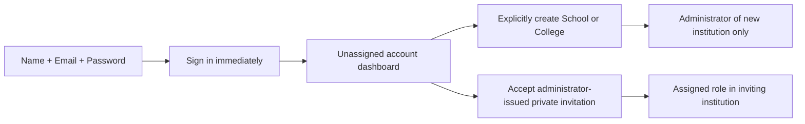

# Email + Password signup and institution onboarding

Signup requires only Name, Email and Password. No OTP, verification email, SMTP
configuration or paid service is used. Passwords require 12–128 characters and are
hashed with Argon2id. Signup creates an active account with **no institution membership
or administrative privileges**. Sign in immediately to reach the onboarding dashboard.

Choose School or College and an institution name, then explicitly select Create workspace.
This creates a new isolated institution and assigns its creator institution-administrator
rights only there. Existing institutions cannot be selected or joined through public signup.
School calendars start with 40-minute periods/recess/lunch; College calendars use lectures.
The existing CSP and CP-SAT engines, academic records and role permissions are preserved.



## Start locally

PowerShell from `D:\My_Codex\CampusFlow`:

```powershell
.venv\Scripts\python scripts/dev_onboarding.py --database data/development-v5.db
```

In another terminal:

```powershell
pnpm.cmd --dir frontend dev
```

Open http://127.0.0.1:5173/sign-up. The filename retains `v5` for compatibility; the
current schema is v6. The launcher initializes/migrates this selected database without
resetting it. The approved reset has already been performed: **do not delete it again**.
No email receiver needs to be started. Optional dependency installation, if missing:

```powershell
.venv\Scripts\python -m pip install -e ".[api,api-test,product,dev,cp-sat]"
pnpm.cmd --dir frontend install --frozen-lockfile
```

## Create the first administrator

1. Sign up with your name, email and a unique password.
2. Sign in with that email/password; no email link is required.
3. Choose School or College, enter its name and click Create workspace.
4. The institution dashboard opens. Configure records or load the demo catalog into
   your empty institution from Settings. Invite staff/students from Users & access.

This does not create a platform super administrator. Platform provisioning remains a
trusted local command only. Public signup cannot choose roles or institution IDs.

## Invitations without email delivery

An institution administrator selects the invited email, role and teacher/batch associations.
Create invitation returns a private link displayed only on creation or rotation. Share it
securely with the intended recipient. No mail is sent. Links expire after 72 hours, are
single-use, and can be rotated or revoked. A new recipient chooses their password. An
already registered recipient must be signed into the matching email account and provide
its current password; an existing institution membership cannot be transferred by a link.
Acceptance revokes old sessions; sign in again to load the assigned institution role.
Treat invitation links like temporary credentials; anyone holding an unclaimed new-account
link can accept it. Emails are identifiers, not verified evidence of mailbox ownership.

## API and settings

- `POST /api/onboarding/register`: `{name,email,password}` -> 201; no login session or role grant.
- `POST /api/auth/login`: `{username: email,password}` -> session cookie + CSRF token.
  The legacy `username` API key and local-provisioned usernames remain compatible.
- `POST /api/onboarding/workspace`: authenticated `{institution_name,institution_type}`
  -> 201, fresh session and new institution administrator membership.
- `GET /api/onboarding/status`: reports signup availability; email_verification_required=false.
- `POST /api/onboarding/accept-invitation`: `{token,password}`; role/tenant derived from stored invitation.
- `/api/auth/session`, `/logout`, `/password`, `/users` retain their security controls.
- `/api/auth/invitations` create/list and `/{id}/resend` (rotate link), `DELETE /{id}` (revoke).
- Verification/resend-registration endpoints are retired; old frontend verification routes
  redirect to sign-in without activating any account. Legacy tables remain intact.

`CAMPUSFLOW_ONBOARDING_ENABLED=0` closes public signup; default is enabled.
`CAMPUSFLOW_DATABASE_URL` chooses the database for direct uvicorn/CLI usage; the launcher
sets it explicitly to its database argument. `CAMPUSFLOW_ENV=development` is local-only.
A private `CAMPUSFLOW_SESSION_SECRET` preserves sessions/invitation digests across restarts;
without it, development restarts invalidate them. Production requires at least 32 characters,
HTTPS and explicit `CAMPUSFLOW_ALLOWED_ORIGINS`. Vite's `CAMPUSFLOW_API_TARGET` defaults to
http://127.0.0.1:8000. No SMTP/email environment variables are required.

## Recovery and limits

Password recovery remains the secure local `reset-password` command documented in
OPERATIONS.md. No public email-recovery service is introduced. One institution per account,
SQLite/single-process deployment and two concurrent solver jobs remain current limits.
Public signup is not proof of institution affiliation; it can create only a new workspace.
